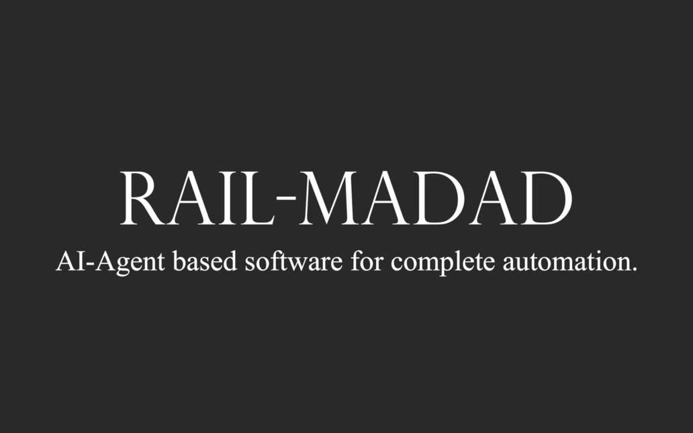
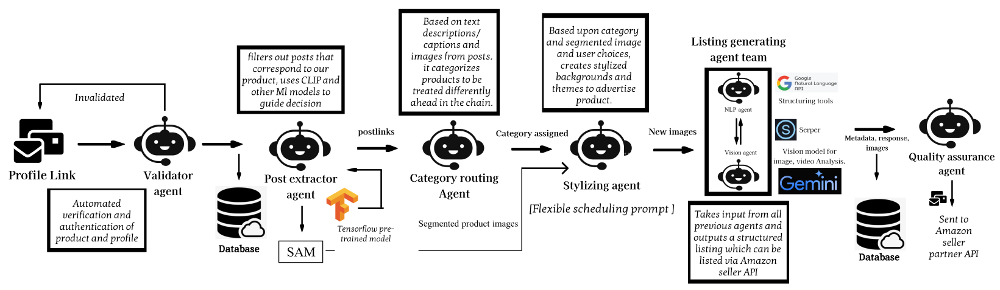
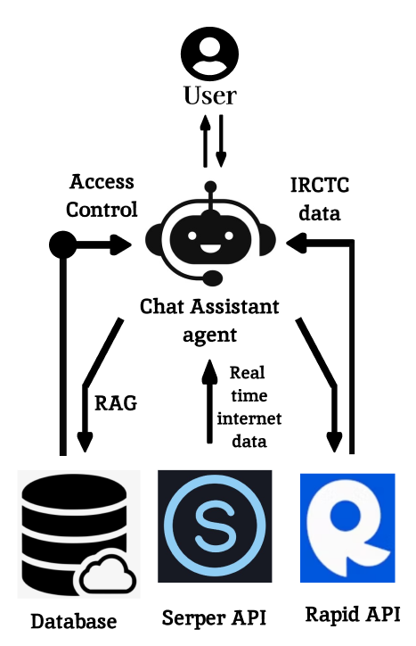
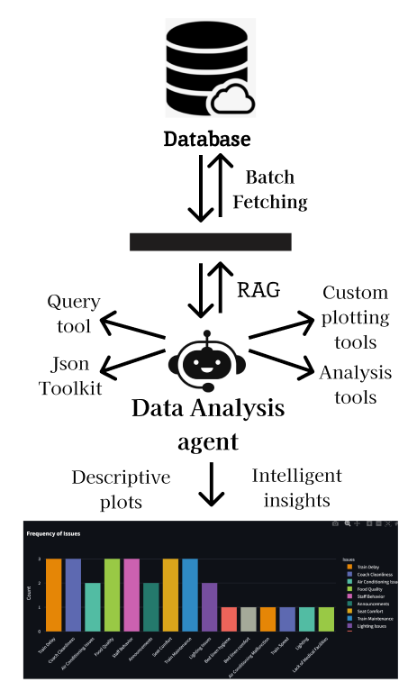

# Rail-Madad (SIH 1711)

AI-driven autonomous workflow for railway complaint management with role-based dashboards, AI routing, and analytics.

## Features

- AI complaint analysis and multi-department routing
- Role-based access (Passenger, Staff, Supervisor, Admin, Analyst)
- Complaint logging, status updates, and analytics dashboards
- Live chat assistant with train info lookup

## Quickstart (Windows PowerShell)

```bash
python -m venv myenv
myenv\Scripts\activate
pip install -r requirements.txt
```

### Run the full RBAC app (recommended)

```bash
streamlit run main_app.py
```

### Run the minimal demo UI

```bash
streamlit run app.py
```

## Configuration

The app reads secrets from Streamlit `st.secrets` and falls back to environment variables.

### Required API keys

- `GEMINI_API_KEY` (Google Generative AI)
- `RAPID_API_KEY` (Indian Railway API via RapidAPI)
- `SERPER_API_KEY` (Google search via Serper)

Optional:

- `GEMINI_MODEL_NAME` (default: `gemini-1.5-pro`)

### How to provide secrets

You can set them as environment variables before running Streamlit:

```powershell
$env:GEMINI_API_KEY="<your_gemini_key>"
$env:RAPID_API_KEY="<your_rapidapi_key>"
$env:SERPER_API_KEY="<your_serper_key>"
```

Or create `.streamlit/secrets.toml`:

```toml
[api_keys]
GEMINI_API_KEY = "<your_gemini_key>"
RAPID_API_KEY = "<your_rapidapi_key>"
SERPER_API_KEY = "<your_serper_key>"

[model]
GEMINI_MODEL_NAME = "gemini-1.5-pro"
```

Gemini free key guide: [Get API key](https://www.linkedin.com/pulse/step-by-step-guide-using-google-gemini-free-api-calls-image-text-y3noc/)

RapidAPI IRCTC playground: `https://rapidapi.com/rahilkhan224/api/indian-railway-irctc/playground`

## Authentication & Roles

The RBAC app (`main_app.py`) loads `auth/credentials.yaml`. For local testing, copy and edit the example:

```bash
copy auth\credentials_example.yaml auth\credentials.yaml
```

All example accounts use password `test123` by default.

| Role                    | Username                |
| ----------------------- | ----------------------- |
| Admin                   | `admin1`                |
| Analyst                 | `analyst1`              |
| Supervisor (Commercial) | `supervisor_commercial` |
| Staff (Commercial)      | `staff_commercial`      |
| Passenger               | `passenger1`            |

You can customize users, roles, and departments in `auth/credentials.yaml`.

## Data and Logs

- Complaints are stored in `log_file.json` at the repo root.
- When a complaint covers multiple departments, the app creates department-specific sub-complaints that share the same complaint number (`cno`).

## Project Structure (high level)

- `main_app.py`: RBAC Streamlit application (multi-role dashboards)
- `app.py`: Minimal demo interface (Home, LiveChat, Directory, Lodger)
- `agents.py`, `tasks.py`, `main.py`: AI agents and Crew orchestration
- `helperfunctions.py`: complaint storage, analytics helpers
- `tools.py`: external tools (train status, search, wiki)
- `auth/`: RBAC helpers and credentials
- `app_pages/`: role-based page modules
- `vars.py`: department mapping and issue routing hints

## Troubleshooting

- Missing Gemini key: AI features will be disabled and a Streamlit warning appears. Set `GEMINI_API_KEY`.
- Missing Serper key: Internet search tool returns a friendly message; chat still works without web search.
- Missing RapidAPI key: Train status tools return mocked responses.
- YAML not found: Create `auth/credentials.yaml` (copy from the example).

## Gallery



### Agent Workflow



#### Other Agent Architectures

<div align="center">
<table>
  <tr>
    <th>Chatbot</th>
    <th>Data Mining agent</th>
  </tr>
  <tr>
    <td></td>
    <td></td>
  </tr>
</table>
</div>

<br/>

### Video Overview

[](https://www.youtube.com/watch?v=Ts_lwYFlMB4)
